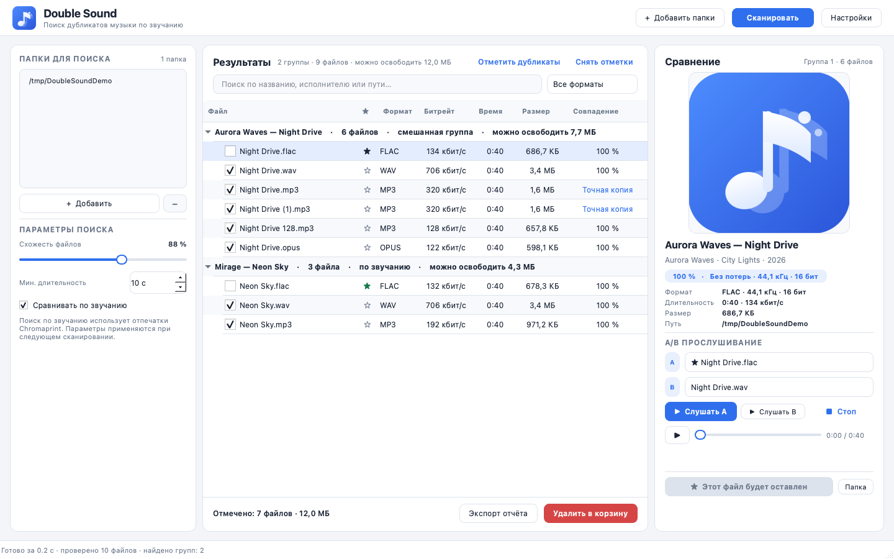
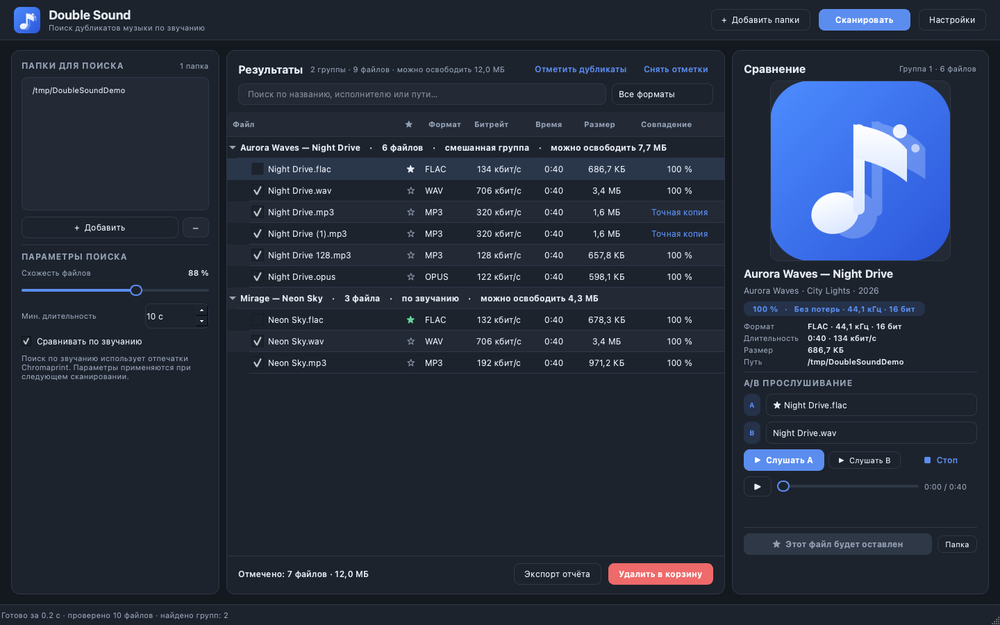

# Double Sound

**Поиск дубликатов музыки для Windows 10/11** с понятным интерфейсом на русском языке.

Программа находит не только побайтово одинаковые файлы, но и **одну и ту же песню
в разных форматах и битрейтах** — например, MP3 320, FLAC и WAV одной записи.



<details>
<summary>Скриншот тёмной темы</summary>



</details>

## Возможности

- **Точные копии** — сравнение по SHA-256.
- **Одна песня в разном качестве** — акустические отпечатки Chromaprint:
  MP3 128, MP3 320, FLAC, WAV, M4A, OGG и другие форматы одной записи
  распознаются как дубликаты.
- **Группы дубликатов** с подсказкой, какую копию лучше оставить:
  без потерь (включая ALAC в M4A) → выше частота и разрядность →
  компактный формат → битрейт.
- **Прослушивание и A/B-сравнение** прямо в программе: переключение между
  двумя файлами сохраняет позицию воспроизведения.
- **Отчёт**: таблица с путями, тегами, качеством и отметками; экспорт в CSV
  (открывается в Excel).
- **Удаление только в корзину** и только после подтверждения. Нельзя удалить
  все файлы группы — хотя бы одна копия песни всегда остаётся.
- **Кэш анализа**: повторное сканирование тех же папок занимает секунды.
- Светлая и тёмная темы, drag-and-drop папок, поиск по результатам.
- Работает **полностью офлайн**, ничего никуда не отправляет.

## Как это работает

1. Программа обходит выбранные папки и читает теги (исполнитель, название,
   альбом, длительность, битрейт).
2. Для файлов, совпавших по размеру и быстрому хешу, считается SHA-256 —
   так находятся точные копии.
3. Для каждой уникальной записи вычисляется отпечаток Chromaprint
   (первые 120 секунд). Отпечатки сравниваются по доле битовых ошибок:
   у одной и той же записи схожесть обычно 99–100 %, у разных песен — около 50 %.
4. Файлы, прошедшие порог схожести (по умолчанию **88 %**), объединяются
   в группы. Внутри группы выбирается лучшая копия.

Порог можно менять в настройках: выше — строже поиск, ниже — больше
«похожих» находок.

## Быстрый старт (Windows)

Готовая сборка — портативная папка, установка не нужна:

1. Распакуйте `DoubleSound-win64.zip`.
2. Запустите `DoubleSound.exe`.
3. Нажмите **«+ Добавить папки»** и выберите папку с музыкой.
4. Нажмите **«Сканировать»**.
5. Прослушайте файлы в группе, при необходимости нажмите **«★ Оставить этот файл»**,
   отметьте лишние галочками и нажмите **«Удалить в корзину»**.

`fpcalc.exe` (Chromaprint) уже входит в сборку — ничего доустанавливать не нужно.

## Запуск из исходников

Нужен Python 3.11+ (64-бит).

```bash
python -m venv .venv

# Windows
.venv\Scripts\activate

# macOS / Linux
source .venv/bin/activate

pip install -r requirements.txt
python run.py
```

Для поиска по звучанию нужен `fpcalc`:

- **Windows** — `app/resources/fpcalc.exe` уже лежит в репозитории;
- **macOS** — `brew install chromaprint`;
- **Linux** — установите пакет `chromaprint` / `libchromaprint-tools`.

Без `fpcalc` программа найдёт только точные копии и покажет предупреждение.

## Сборка Windows-версии

На Windows 10/11 x64:

```bat
build_windows.bat
```

Скрипт создаст виртуальное окружение, установит зависимости, при необходимости
скачает `fpcalc.exe`, прогонит тесты и соберёт:

- `dist\DoubleSound\DoubleSound.exe` — портативная программа;
- `dist\DoubleSound-win64.zip` — архив для переноса на другой компьютер.

Сборка выполняется только на Windows: PyInstaller не умеет кросс-компилировать
Windows-исполняемые файлы с macOS/Linux. В репозитории есть готовый
GitHub Actions workflow (`.github/workflows/build-windows.yml`) — он собирает
архив автоматически.

Сборка не подписана цифровой подписью, поэтому при первом запуске Windows
SmartScreen может показать предупреждение. Нажмите «Подробнее» → «Выполнить
в любом случае», если скачали архив из доверенного источника.

## Использование

| Действие | Как |
| --- | --- |
| Добавить папки | Кнопка «+ Добавить папки», `Ctrl+O` или перетащите папки в окно |
| Сканировать | Кнопка «Сканировать» или `F5` |
| Остановить | «Отмена» или `Esc` |
| Прослушать | Выберите файл и нажмите `Пробел` / кнопку ▶ |
| Сравнить A/B | Выберите файлы в списках A и B, нажимайте «Слушать A» / «Слушать B» — позиция сохраняется |
| Оставить копию | Клик по ★ в строке или кнопка «Оставить этот файл» |
| Отметить лишние | Галочки в строках или «Отметить дубликаты» |
| Отчёт | «Экспорт отчёта» → CSV |
| Удалить | «Удалить в корзину» (только после подтверждения) |
| Фильтр | Поиск по названию/пути и выбор формата над таблицей |

Двойной клик по строке запускает воспроизведение. Правый клик открывает
меню: открыть папку, открыть в системном плеере, скопировать путь.

## Настройки

- **Минимальная схожесть** — порог акустического совпадения (по умолчанию 88 %).
- **Минимальная длительность** — короткие файлы (звуки, рингтоны) не участвуют.
- **Анализировать фрагмент** — сколько секунд с начала песни использовать
  для отпечатка (120 с — оптимально).
- **Потоков анализа** — параллельность чтения файлов.
- **Тема оформления** — светлая или тёмная.
- **Кэш анализа** — можно очистить; после этого отпечатки будут рассчитаны заново.

## Поддерживаемые форматы

MP3, FLAC, WAV, M4A/AAC/ALAC, OGG, OPUS, WMA, AIFF, APE, WV.

Встроенный плеер (Qt Multimedia) уверенно играет MP3, WAV, FLAC, M4A.
Для экзотических форматов используйте «Открыть в системном плеере».

## Где хранятся данные

- В портативной сборке — папка `data` рядом с `DoubleSound.exe`:
  `data\fingerprints.sqlite3` (кэш) и `data\settings.ini` (настройки).
- Если папка программы защищена от записи, используется системный каталог
  (`%APPDATA%\DoubleSound` на Windows).
- При запуске из исходников — системный каталог приложения.
- Никакие данные не покидают компьютер.

## Ограничения

- Разные **мастер-записи**, концертные версии, ремиксы и радиоверсии могут
  не совпасть по отпечатку — это ожидаемо.
- Отпечаток строится по началу записи. Если у версий сильно отличаются
  вступления, автоматическое совпадение может не сработать — проверьте такие
  файлы вручную.
- Файлы, к которым нет доступа, пропускаются; список сообщений доступен
  в строке состояния после сканирования.

## Тесты

```bash
pip install -r requirements-dev.txt
python -m pytest -q
```

Интеграционные тесты генерируют аудио и требуют `ffmpeg` и `fpcalc`
(иначе автоматически пропускаются).

## Лицензия

Исходный код — MIT, см. [LICENSE](LICENSE). Готовая сборка включает сторонние
компоненты (Qt, FFmpeg, mutagen, Chromaprint и другие); их лицензии и условия
распространения перечислены в [THIRD_PARTY_NOTICES.md](THIRD_PARTY_NOTICES.md).
